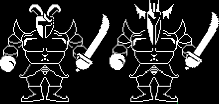
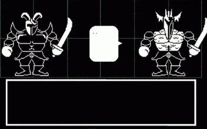
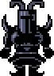
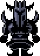

# Royal Guards (Undertale Wiki)
Source: https://undertale.fandom.com/wiki/Royal_Guards (CC BY-SA)
   

*For the monster group, see [Royal
Guard](/wiki/Category:Royal_Guard "Category:Royal Guard").*

## Royal Guards

- 
  Battle 
- 
  RG 01 Overworld 
- 
  RG 02 Overworld 

<figure class="pi-item pi-image">

</figure>

<figure class="pi-item pi-image">

</figure>

<figure class="pi-item pi-image">

</figure>

Two lovers staring over the edge of the cauldron of hell.

## Character Information

### First Appearance

[Hotland](/wiki/Hotland "Hotland")

## Battle Information

### HP

150 (Both)

### AT

30 \[8\] (Both)

### DF

20 \[4\] (Both)

### EXP On Kill

220

### GOLD On Win

- 110 (Kill)
- 100 (Spare)

### ACTs

Check, Clean Armor, Whisper

## Epilogue

### White Text

\[N/A\]

### Yellow Text

Use Your Imagination

The **Royal Guards** are a mini-boss duo [the
protagonist](/wiki/Frisk "Frisk") encounters in the upper levels of
[Hotland](/wiki/Hotland "Hotland"). Shown by their names, they are
members of the Royal Guard. Royal Guard 01 experiences romantic
attraction towards Royal Guard 02, as portrayed in the dialogues during
the battle.

## Contents

- [1 In
  Battle](#In_Battle)
  - [1.1
    Attacks](#Attacks)
  - [1.2
    Strategy](#Strategy)
  - [1.3
    Quotes](#Quotes)
    - [1.3.1
      Pre-Battle](#Pre-Battle)
    - [1.3.2
      Battle](#Battle)
  - [1.4 Flavor
    Text](#Flavor_Text)
- [2
  Gallery](#Gallery)
- [3
  Trivia](#Trivia)
- [4
  References](#References)

## In Battle\[\]

### Attacks\[\]

- The guards fight together using "Team Attacks" from the bottom and top
  of the screen. These attacks consist of:
  - Projectiles that drop from top of the screen in a similar fashion to
    one of [Vegetoid](/wiki/Vegetoid "Vegetoid")'s attacks.
  - Star-like bullets that move vertically from the bottom and top of
    the screen.
- If one guard is killed, the other's attacks double in intensity and
  become much harder to dodge.
- If 02 takes off his armor, the attacks from the top of the screen
  become erratic and fall out the side of the [Bullet
  Board](/wiki/Bullet_Board "Bullet Board").

### Strategy\[\]

- To spare this duo, the protagonist must clean Royal Guard 02's armor,
  and interact with the Green projectile five times.
  - At this point, Royal Guard 01's attacks become shaky and easy to
    dodge.
- Once 02's armor comes off, whisper to 01 to be honest about his
  feelings.
- Although the Royal Guards can be spared after this point, not doing so
  causes them to continue attacking the protagonist's
  [SOUL](/wiki/SOUL "SOUL") as usual.

### Quotes\[\]

#### Pre-Battle\[\]

Normal

- *Hey! You! Stop!*
- *We've, like, received an anonymous tip about a human wearing a
  striped shirt.*
- *They told us they were wandering around Hotland right now...*
- *I know, sounds scary, huh?*
- *Well, just stay chill. We'll bring you someplace safe, OK?*
- *... Huh? What is it, bro?*
- *The shirt they're wearing?*
- *... like, what about it?*
- *Bro...*
- *Are you thinkin... What I'm thinkin?*
- *Bummer. This is, like... Mega embarrassing.*
- *We, like, actually totally have to kill you and stuff.*

Genocide

- *... you're here.*
- *So that means Undyne... She's...*
- *Like, Undyne! We'll avenge you!*

#### Battle\[\]

RG 01

- *Like, team attack!* **\[Encounter\]**
- *Like, give us the soul brah.* **\[Neutral\]**
- *Like, "you're dead" and all.* **\[Neutral\]**
- *Like, prepare to die, right?* **\[Neutral\]**
- *Like, perish and stuff.* **\[Neutral\]**
- *Like... what? I don't get it.* **\[Whisper before successfully
  cleaning RG 02's armor\]**
- *Like, hands off the merch.* **\[Clean Armor\]**
- *D... Dude...* **\[After successfully cleaning RG 02's armor\]**
- *I... I...* **\[Whisper after successfully cleaning RG 02's armor\]**
- *H-HEY, STOP THAT!!* **\[Clean Armor to RG 02 after successfully
  cleaning RG 02's armor\]**

RG 02

- *... team attack.* **\[Encounter\]**
- *... ... ... sigh.* **\[Neutral\]**
- *... ... heh.* **\[Neutral\]**
- *... ... what?* **\[Neutral\]**
- *... ... hmph.* **\[Neutral\]**
- *... i won't tell.* **\[Whisper\]**
- *... getting ... warmer.* **\[Clean Armor\]**
- *... hello.* **\[Clean Armor after successfully cleaning armor\]**
- **\[Clean Armor to RG 02, successful\]**
  - *... can't ... take it.*
  - *... armor... too... HOT!!!*
  - *... much better.*

RG 01 (alone)

- *02... I never told him...* **\[Encounter\]**
  - *02!? B-but why!?* **\[If could be spared before\]**
- *02... this is, like, for you.* **\[Neutral\]**
- *Like, 02...* **\[Neutral\]**
- *02... are you really..* **\[Neutral\]**
- *...* **\[Neutral\]**

RG 02 (alone)

- *01... you...! ..!!!!* **\[Encounter\]**
  - *01...!? What the...!?* **\[If could be spared before\]**
- *...* **\[Neutral\]**

Royal Guard (Sparing Method)

- **\[RG 01\]** *D-dude ...*
- **\[RG 01\]** *I can't ...*
- **\[RG 01\]** *I can't take this anymore!*
- **\[RG 01\]** *Not like this!!*
- **\[RG 01\]** *Like, 02! I like...*
- **\[RG 01\]** *I like, LIKE you, bro!*
- **\[RG 01\]** *The way you fight... The way you talk...*
- **\[RG 01\]** *I love doing team attacks with you.*
- **\[RG 01\]** *I love standing here with you, bouncing and waving our
  weapons in sync...*
- **\[RG 01\]** *02... I, like, want to stay like this forever...*
- **\[RG 02\]** *...*
- **\[RG 02\]** *....*
- **\[RG 01\]** *Uh...*
- **\[RG 01\]** *I mean, uh...*
- **\[RG 01\]** *Psyche! Gotcha, bro!!! Haha!* **\[Normal\]**
- **\[If the protagonist called [Undyne](/wiki/Undyne "Undyne") in the
  Laboratory Entrance when the guards were still blocking the path\]**
  - **\[RG 01\]** *Whew, bro! That human,*
  - **\[RG 01\]** *Put me under, uh, mind control!*
  - **\[RG 01\]** *What was I just saying?*
  - **\[RG 01\]** *It's all a blur, dude!! Whoops!*
- **\[RG 02\]** *... 01.*
- **\[RG 01\]** *Y-yeah, bro??*
- **\[RG 02\]** *...*
- **\[RG 02\]** *... do you want to, you disgusting...*
- **\[RG 02\]** *... get some ice cream...*
- **\[RG 02\]** *... after this?*
- **\[RG 01\]** *Like...* **\[Unused\]**
- **\[RG 01\]** *Sure, dude! Haha!*

### Flavor Text\[\]

Royal Guard

- *Royal Guard attacks!* **\[Encounter\]**
- *Sweat pours from 02's armor.* **\[Neutral\]**
- *01 is polishing his face.* **\[Neutral\]**
- *01 stands guard.* **\[Neutral\]**
- *02 watches your movements.* **\[Neutral\]**
- *Smells like a military zoo.* **\[Neutral\]**
- *02 seems to be bothered by his outfit.* **\[Neutral; unused\]**

<figure class="thumb show-info-icon" typeof="mw:File/Thumb"
style="width: 275px">

<figcaption></figcaption>
</figure>

- *You tell RG 01 to be honest with his feelings.* **\[Whisper to RG
  01\]**
- *You tell RG 02 your favorite secret.* **\[Whisper to RG 02\]**
- *You attempt to touch RG 01's armor. Your hands slip off.* **\[Clean
  Armor to RG 01\]**
- *You clean RG 02's armor. Its cooling dirt begins to wash away.*
  **\[Clean Armor to RG 02\]**
- *You pat RG 02's chest like a muscular bongo.* **\[Clean Armor to RG
  02 after successfully cleaning RG 02's armor\]**
- *RG 01 looks bothered by something.* **\[After Clean Armor to RG
  02\]**
- *02's breathing intensifies.* **\[Low HP\]**
- *01 and 02 are looking at each other happily.* **\[Spare conditions
  met\]**

RG 01

- *Royal Guard member with shining, polished armor.* **\[Check\]**
  - *I see two lovers staring over the edge of the cauldron of hell.*
    **\[Genocide Route\]**
- *01 holds his head in his hands.* **\[Neutral\]**
- *Anguished noises come from inside 01's armor.* **\[Neutral\]**
- *01 stands still.* **\[Neutral\]**
- *01 doesn't know what to do.* **\[Neutral\]**
- *01's breathing intensifies.* **\[Low HP\]**

RG 02

- *Royal Guard member with stuffy armor.* **\[Check\]**
  - **\[Genocide Route\]**
    - *Do they both wish for death? That means their love will end in
      hell.*
    - *I couldn't stop laughing.*
- *02 is clenching and unclenching his fists.* **\[Neutral\]**
- *02 is shaking his head.* **\[Neutral\]**
- *02 is striking his sword against the ground.* **\[Neutral\]**
- *02 is coughing.* **\[Neutral\]**
- *You were repelled.* **\[Clean Armor\]**

## Gallery\[\]

Royal Guards' official tarot card as Major Arcana VI, "The Lovers".

Sprite sheet from the UNDERTALE art book depicting different sprite
concepts for the characters, and even some concepts for 03 and 04.

Artwork from *Undertale*'s 5th anniversary.

## Trivia\[\]

- Their sprites are named with the word
  "<a href="https://en.wikipedia.org/wiki/Bara_(genre)" class="extiw"
  title="wikipedia:Bara (genre)">bara</a>," which is a misnomer of a
  Japanese genre of artwork and fictional media that features homosexual
  men and traditional masculinity made by gays.
- <a href="https://youtu.be/TC3plNwe9SM?t=22m10s" class="external text"
  target="_blank" rel="nofollow noreferrer noopener">A call from
  Undyne</a> informs the protagonist of their species—RG 01 a bunny, and
  RG 02 a dragon—and that RG 01 requested to patrol with RG 02.
  - Their in-game sprites (*spr_royalguard_rabbit_d_0* and
    *spr_royalguard_dragon_d_0*) also prove their species.
- If the protagonist calls Undyne and [Papyrus](/wiki/Papyrus "Papyrus")
  in the first room they see the Guards in, she goes on to talk about
  how she believes humans have mind control powers due to an anime that
  [Alphys](/wiki/Alphys "Alphys") showed her, and ordered the Guards not
  to listen to her if she ever defended a human. Later, in battle, after
  01 confesses his feelings to 02; instead of saying he was just joking,
  he blames his confession on human mind control.
- If the protagonist kills 02 while he has his chest visible, he appears
  to have his armor back on for a split second before he turns to dust.
- RG 01 and RG 02 are the only sprites in the game that have bouncing
  animations when talked to.
- After sparing them, the newfound couple can then be found at the top
  of Hotland, just before the [MTT
  Resort](/wiki/MTT_Resort "MTT Resort"), having bought all of the [Nice
  Cream](/wiki/Nice_Cream "Nice Cream") from the [Nice Cream
  Guy](/wiki/Nice_Cream_Guy "Nice Cream Guy"). The protagonist is unable
  to purchase Nice Cream from the vendor.
  - If the [Genocide Route](/wiki/Genocide_Route "Genocide Route") is
    aborted by sparing them, they do not appear in this area because the
    Nice Cream Guy, like the other NPCs, is absent.
- The Royal Guards are the only monsters not to have an explicit
  description of their circumstances in the [ending
  credits](/wiki/True_Pacifist_Ending_Credits "True Pacifist Ending Credits")
  sequence. The description is simply "*Use your imagination*," and is
  up to the [players](/wiki/Player "Player") to decide.
  - In the credits, RG 01 starts to sweat as he did in battle. However,
    RG 02 still has his armor on.
- Their Genocide Route check descriptions are indirect quotes from
  Banana Yoshimoto's 1988 Japanese novel
  "*Kitchen*."[\[1\]](#cite_note-1)
- There are two unused sprites for two more Guards, [RG 03 and RG
  04](/wiki/Cut_Enemies#RG_03_and_RG_04 "Cut Enemies"). 03 appears to be
  a bug-like monster similar to a praying mantis and 04 appears to be a
  feline monster. They have a similar sparing mechanic, being two women
  who used to be friends but had a falling out.
- In the artbook, Toby Fox mentions and shows "ASURA", a cut amalgamate
  of all 4 royal guards.
- Royal
  Guards[\[2\]](#cite_note-2)
  have unused white description.

## References\[\]

1.  [↑](#cite_ref-1)
    *whoa Chara....didn't know you read
    Japanese literature from over a decade from when you fell down the
    hole in 201X* -
    <a href="http://undertale-science.tumblr.com/post/136011592623"
    class="external text" target="_blank"
    rel="nofollow noreferrer noopener">undertale-science on Tumblr,</a>
    December 26, 2015.
2.  [↑](#cite_ref-2)
    *Use Your Imagination* - Royal Guards,
    white description

## [Characters](/wiki/Category:Characters "Category:Characters")

### [Main Characters](/wiki/Category:Main_characters "Category:Main characters")

[Frisk](/wiki/Frisk "Frisk") • [Flowey](/wiki/Flowey "Flowey")
• [Toriel](/wiki/Toriel "Toriel") • [Sans](/wiki/Sans "Sans")
• [Papyrus](/wiki/Papyrus "Papyrus") • [Undyne](/wiki/Undyne "Undyne")
• [Alphys](/wiki/Alphys "Alphys")
• [Mettaton](/wiki/Mettaton "Mettaton") • [Asgore
Dreemurr](/wiki/Asgore_Dreemurr "Asgore Dreemurr")  
[Asriel Dreemurr](/wiki/Asriel_Dreemurr "Asriel Dreemurr")
• [Chara](/wiki/Chara "Chara")

### [Ruins](/wiki/Ruins "Ruins") Enemies

[Dummy](/wiki/Dummy "Dummy") • [Froggit](/wiki/Froggit "Froggit")
• [Whimsun](/wiki/Whimsun "Whimsun")
• [Moldsmal](/wiki/Moldsmal "Moldsmal") • [Loox](/wiki/Loox "Loox")
• [Vegetoid](/wiki/Vegetoid "Vegetoid")
• [Migosp](/wiki/Migosp "Migosp")
• [Napstablook](/wiki/Napstablook "Napstablook")

### [Snowdin](/wiki/Snowdin "Snowdin") Enemies

[Snowdrake](/wiki/Snowdrake "Snowdrake")
• [Chilldrake](/wiki/Chilldrake "Chilldrake") • [Ice
Cap](/wiki/Ice_Cap "Ice Cap") • [Gyftrot](/wiki/Gyftrot "Gyftrot")
• [Doggo](/wiki/Doggo "Doggo")  
[Dogamy and
Dogaressa](/wiki/Dogamy_and_Dogaressa "Dogamy and Dogaressa") • [Lesser
Dog](/wiki/Lesser_Dog "Lesser Dog") • [Greater
Dog](/wiki/Greater_Dog "Greater Dog") • [Jerry](/wiki/Jerry "Jerry")
• [Glyde](/wiki/Glyde "Glyde") • [Mad Mew
Mew](/wiki/Mad_Mew_Mew "Mad Mew Mew")

### [Waterfall](/wiki/Waterfall "Waterfall") Enemies

[Aaron](/wiki/Aaron "Aaron") • [Moldbygg](/wiki/Moldbygg "Moldbygg")
• [Woshua](/wiki/Woshua "Woshua") • [Temmie](/wiki/Temmie "Temmie")
• [Mad Dummy](/wiki/Mad_Dummy "Mad Dummy")
• [Shyren](/wiki/Shyren "Shyren")

### [Hotland](/wiki/Hotland "Hotland") Enemies

[Vulkin](/wiki/Vulkin "Vulkin")
• [Tsunderplane](/wiki/Tsunderplane "Tsunderplane")
• [Pyrope](/wiki/Pyrope "Pyrope") • [Muffet](/wiki/Muffet "Muffet")
• **Royal Guards** • [So Sorry](/wiki/So_Sorry "So Sorry")

### [CORE](/wiki/CORE "CORE") Enemies

[Final Froggit](/wiki/Final_Froggit "Final Froggit")
• [Whimsalot](/wiki/Whimsalot "Whimsalot")
• [Astigmatism](/wiki/Astigmatism "Astigmatism")
• [Madjick](/wiki/Madjick "Madjick") • [Knight
Knight](/wiki/Knight_Knight "Knight Knight")

### [Amalgamates](/wiki/Category:Amalgamates "Category:Amalgamates")

[Memoryhead](/wiki/Memoryhead "Memoryhead")
• [Endogeny](/wiki/Endogeny "Endogeny") • [Reaper
Bird](/wiki/Reaper_Bird "Reaper Bird") • [Lemon
Bread](/wiki/Lemon_Bread "Lemon Bread") • [Snowdrake's
Mother](/wiki/Snowdrake%27s_Mother "Snowdrake's Mother")

### [Hard Mode-only enemies](/wiki/Category:Hard_Mode_Enemies "Category:Hard Mode Enemies")

[Parsnik](/wiki/Parsnik "Parsnik")
• [Moldessa](/wiki/Moldessa "Moldessa")
• [Migospel](/wiki/Migospel "Migospel")

### [Vendors](/wiki/Category:Vendors "Category:Vendors")

[Nice Cream Guy](/wiki/Nice_Cream_Guy "Nice Cream Guy") • [Snowdin
Shopkeeper](/wiki/Snowdin_Shopkeeper "Snowdin Shopkeeper")
• <a href="/wiki/Gerson" class="mw-redirect" title="Gerson">Gerson</a>
• [Tem Shop](/wiki/Tem_Shop "Tem Shop") • [Bratty and
Catty](/wiki/Bratty_and_Catty "Bratty and Catty")
• [Burgerpants](/wiki/Burgerpants "Burgerpants")

### [NPCs](/wiki/Category:NPCs "Category:NPCs")

[Ruins](/wiki/Ruins/NPCs "Ruins/NPCs")
• [Snowdin](/wiki/Snowdin/NPCs "Snowdin/NPCs")
• [Waterfall](/wiki/Waterfall/NPCs "Waterfall/NPCs")
• [Hotland](/wiki/Hotland/NPCs "Hotland/NPCs") • [MTT
Resort](/wiki/MTT_Resort/NPCs "MTT Resort/NPCs") • [True
Lab](/wiki/True_Lab/NPCs "True Lab/NPCs")

### Other Characters

<a href="/wiki/Photoshop_Flowey" class="mw-redirect"
title="Photoshop Flowey">Photoshop Flowey</a> • [Monster
Kid](/wiki/Monster_Kid "Monster Kid") • [Annoying
Dog](/wiki/Annoying_Dog "Annoying Dog") • [River
Person](/wiki/River_Person "River Person") • [Eight
Humans](/wiki/Eight_Humans "Eight Humans") • [W. D.
Gaster](/wiki/W._D._Gaster "W. D. Gaster") • [Lost
Souls](/wiki/Lost_Souls "Lost Souls")

